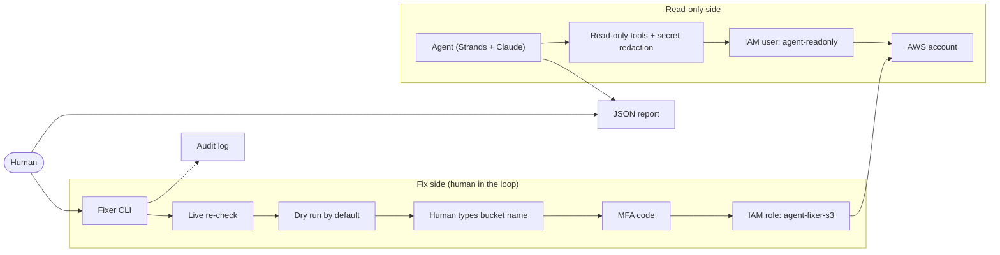

# aws-cost-security-agent

An AI agent that reviews one AWS account for cost waste and security problems,
explains each problem in simple words, and ranks it by risk.

**The agent is read-only. It cannot change anything.** Any fix needs a human
to approve it, and the fix runs through a separate tool with its own limited role.

## What it does

- Finds public S3 buckets, security groups open to the whole internet, and idle EC2 servers.
- Reads month-to-date spend from Cost Explorer.
- Produces a structured JSON report, sorted by risk in code (not left to the model).
- Includes a separate fixer that can turn on S3 Block Public Access, only after
  a dry run, a typed confirmation, and an MFA code.

## Architecture




## Safety design

- **Read-only agent.** The agent has four read tools and no write tool. Its IAM user
  (`agent-readonly`) can only read. Asking it to list IAM users returns `AccessDenied`.
- **Separate fixer.** Only the `fixer/` code can change anything. The agent cannot
  call it.
- **Human in the loop.** The fixer re-checks the bucket live, shows a dry run by
  default, and needs the human to type the exact bucket name before it does anything.
- **MFA and least privilege.** The change uses a separate role (`agent-fixer-s3`).
  It needs an MFA code, can only turn on Block Public Access, and only on buckets
  whose names start with `test-`. The read-only user cannot assume this role.
- **Secret redaction.** Every tool output goes through a redaction step before the
  agent sees it. It is a pattern match, so it can miss unusual secrets.
- **Audit log.** Every proposed, approved, applied and failed fix is written to a
  local log file. Moving it to a cloud store is planned.
- **No guessing.** If a tool has no data or is denied, the report says so. Savings
  are `null` unless they can be calculated from tool data.

## Tests

The tests use fake AWS objects, so they never call real AWS or cost money.

```
python -m pytest -q
```

## Limits

- Scanners cover one region only.
- Redaction and the report checks are not a full security review.
- IAM, encryption and logging settings are not checked. The report lists what was
  not covered.